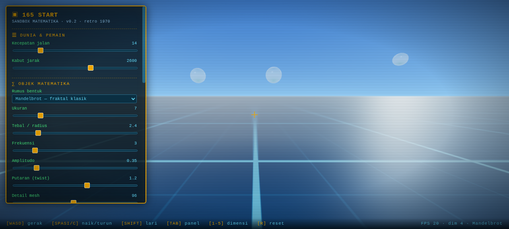

# 165 START 🎲

**Sandbox matematika 3D — dari 1D sampai 5D.**
Sebuah dunia kecil yang bisa kamu ubah apa saja lewat panel parameter:
bentuk lahir dari persamaan, dan persamaannya bisa kamu sentuh langsung.

> *"Dalam kehidupan nyata, apapun adalah bentuk matematika."*



---

## Cara main (paling gampang)

**Windows:** klik dua kali `165START.exe` → game terbuka di jendelanya sendiri.
(Tanpa install apa pun. Tanpa internet.)

**Cara manual / Linux/Mac:** klik dua kali `index.html` — atau klik kanan → *Open with* → Chrome/Edge.

## Tombol

| Tombol | Fungsi |
|---|---|
| `W A S D` | Jalan / terbang bebas |
| `Mouse` | Lihat sekeliling |
| `Spasi` / `C` | Naik / turun |
| `Shift` | Lari (lebih cepat) |
| `Tab` | Buka / tutup panel parameter |
| `1`–`5` | Ganti dimensi hiperkubus (1D…5D) |
| `R` | Kembali ke posisi awal |

## Yang bisa kamu ubah (panel kiri)

- **Dunia** — kecepatan jalan, jarak kabut.
- **Objek matematika** — pilih dari **115 rumus**! Dasar (Torus, Bola, Gelombang), fraktal (Mandelbrot, Julia, Burning Ship, Newton, Sierpinski, Spons Menger), eksotis (Mobius, Superelipsoid, Mawar), **Galeri 50 Tokoh Matematika** (Thales → Wiles, tiap tokoh jadi bentuk 3D dari penemuannya), lalu **50 Bentuk A1–A50**: kardioid, lemniskat, astroid, sikloid, simpul torus, Pita Klein, interferensi, difraksi, pegunungan fraktal, ombak laut, sarang lebah, roda gigi, medan magnet, corong lubang hitam, dan banyak lagi. Lalu atur **ukuran, tebal, frekuensi, amplitudo, twist, detail mesh, iterasi fraktal, eksponen bentuk, tingkat logam, kekasaran, wireframe, flat shading**.
- **Spons Menger** — fraktal 3D: atur level rekursi (0–3, level 3 = 8.000 kubus) dan ukurannya.
- **Hiperkubus 1D → 5D** — dimensi, ukuran, kecepatan rotasi, jarak proyeksi 4D.
- **Tampilan** — cahaya matahari, paparan cahaya.

Semua angka di panel itu **parameter matematika yang sesungguhnya** — mengubahnya mengubah persamaan, dan persamaan mengubah wujud bendanya. Di rumus *Julia*, memutar slider **twist** = memutar konstanta c → setiap sudut menghasilkan fraktal yang berbeda.

## Isi folder

## Isi repo ini

```
index.html              → seluruh game (klik dua kali juga bisa langsung main!)
three.min.js            → mesin 3D (ringan, offline)
preview.png             → tampilan game
README.md               → file ini (otomatis jadi halaman depan repo)
CARA-UPLOAD-GITHUB.md   → panduan upload & FAQ
push-ke-github.bat      → alat bantu push (opsional)
rilis/
  └─ 165START-win64-v0.6.zip → paket Windows lengkap (siap unduh, exe mandiri)
```

Game-nya sendiri hanya ± 1 MB (sangat ringan). Paket Windows di `rilis/` (± 0,5 MB) berisi aplikasi pemutar `165START.exe` + file game + `BACA-DULU.txt`.

## Cara install (dari ZIP) — 3 langkah, tanpa installer

1. **Unduh** `rilis/165START-win64-v0.6.zip` (klik file → tombol **Download**).
2. **Ekstrak**: klik kanan file zip → **Extract All** → Extract.
3. **Main**: klik dua kali **`165START.exe`**.

Selesai. Tidak ada proses install beneran — game ini *portable*, tinggal pakai.

✅ **`165START.exe` sudah mandiri**: file game tertanam di dalamnya, jadi exe boleh dipindah ke mana pun (bahkan jalan tanpa file lain). Kalau file `index.html` ada di sebelah exe, file itulah yang dipakai — jadi hasil edit-mu tetap berlaku.

💡 Bonus: klik kanan `165START.exe` → **Send to** → **Desktop (create shortcut)** supaya gampang dibuka lagi.

💡 Tidak punya Windows? Klik dua kali `index.html` di browser mana pun — jalan juga.

## Untuk yang suka ngoprek

Semua kode ada di `index.html`. Cari tulisan **`PARAM`** untuk mulai mengubah:
ganti angka, simpan file, refresh browser. Tidak perlu compile apa pun.

## Peta jalan (roadmap)

- **v0.1** — dunia 3D, gerak bebas, panel parameter, hiperkubus 1D–5D, efek CRT retro, latar aero. ✅
- **v0.2** — fraktal: Mandelbrot, Julia, Spons Menger, plus Mobius, Superelipsoid, Fibonacci; aplikasi Windows (`165START.exe` 36 KB). ✅
- **v0.3** — tambah Burning Ship, Newton, Sierpinski, Mawar; aplikasi Windows 36 KB. ✅
- **v0.4** — **Galeri 50 Tokoh Matematika** (Thales → Wiles), tiap tokoh jadi bentuk 3D dari penemuannya. ✅
- **v0.5 (sekarang)** — **50 Bentuk Tambahan A1–A50** (geometri klasik, gelombang, fraktal alam, mekanik, benda sehari-hari) → **115 rumus total**. ✅
- **v0.6** — simpan & muat kreasi (JSON), medan vektor, permukaan minimal.
- **v0.7** — objek yang saling berinteraksi (gravitasi, tumbukan sederhana).
- **v1.0** — mode edukasi: tantangan matematika, penjelasan rumus di dalam game, mode multiplayer sederhana.

---

Dibuat dengan semangat: *matematika itu nyata, bisa dipegang, dan bisa dimainkan.*
